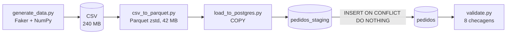

# Pipeline de migração de dados: CSV → Parquet → PostgreSQL

esse projeto converte arquivos CSV em parquet que é um formato de arquivo de armazenamento de dados orientado a colunas, compacta os dados de forma avançada, reduzindo bastante o tamanho dos arquivos em disco, primeiro gerando arquivo csv  de 2 milhões de pedidos ficticios, convertendo para parquet e carrega os dados no Postgres e valida o resultado

## Arquitetura

## Resultados

### CSV vs Parquet (2.001.000 linhas, 13 colunas)

| Arquivo | Tamanho (MB) | Escrita (s) | Leitura completa (s) | Leitura de 1 coluna (s) |
|---|---|---|---|---|
| CSV | 239,89 | n/a | 6,73 | 2,217 |
| Parquet sem compressão | 87,98 | 1,58 | 0,34 | 0,134 |
| Parquet snappy | 57,19 | 1,62 | 0,23 | 0,033 |
| Parquet zstd | 41,90 | 1,91 | 0,25 | 0,027 |

Medição de uma única execução.

### Carga no PostgreSQL

- Linhas na staging: 2.001.000
- Linhas inseridas na tabela final: 2.000.000
- Duplicados descartados: 1.000
- Segunda execução: 0 linhas inseridas (carga idempotente)

### Validação

8 de 8 checagens passaram: 
[OK] Total de linhas: obtido=2000000 | esperado=2000000 
[OK] Pedidos duplicados: obtido=0 | esperado=0 
[OK] Soma de valor_total: obtido=499386755.8 | esperado=499386755.8000001 
[OK] Nulos em cidade: obtido=20000 | esperado=20000 
[OK] Nulos em colunas obrigatórias: obtido=0 | esperado=0 
[OK] Linhas com valor_total incorreto: obtido=0 | esperado=0 
[OK] Linhas com status inválido: obtido=0 | esperado=0 
[OK] Linhas com quantidade inválida: obtido=0 | esperado=0 8 de 8 checagens passaram

## Decisões

- **Por que zstd:** escolhi a compressão zstd por performar melhor em comparação aos outros arquivos parquet com compressão snappy e sem compressão, um CSV que tinha 239,89 MB foi para 41.9 MB
- **Por que staging + tabela final:** escolhi esse padrão, porque usei o COPY  do PostgreSQL, sendo uma maneira mais rapida de carregar milhoes de linhas numa tabela,e o COPY não aceita duplicados na tabela final, pois a tabela `pedidos` tem `id_pedido` como chave primaria, e o arquivo traz 1.000 pedidos repetidos. Se o `COPY` fosse direto para ela, o banco recusaria o primeiro duplicado e cancelaria a carga inteira, perdendo 2 milhões de linhas por causa de 1.000.
- **Por que COPY e não to_sql:** porque é um método do PostgreSQL feito para altos volumes de dados
- **Como a validação funciona:** depois da carga, o validate.py compara o que está no banco com o arquivo de origem. O valor esperado é calculado a partir do Parquet, sem digitar números fixos. São 8 checagens: contagem de linhas, duplicados, soma de valor_total (com tolerância de 0,01 por causa de ponto flutuante), nulos e regras de negócio. Se alguma falhar, o script encerra com erro. Resultado: 8 de 8 checagens passaram.

## Stack

Python, pandas, PyArrow, Faker, NumPy, PostgreSQL 16, Docker Compose, psycopg

## Como rodar

1. `pip install -r requirements.txt`
2. Copie `.env.example` para `.env` e preencha usuário, senha e banco
3. `docker compose up -d`
4. Crie as tabelas: `docker compose exec -T postgres psql -U <usuario> -d <banco> < sql/create_tables.sql`
5. `python src/generate_data.py`
6. `python src/csv_to_parquet.py`
7. `python src/load_to_postgres.py`
8. `python src/validate.py`

## Estrutura do repositório

[cole o resultado do comando `tree /f` ou descreva as pastas]

## O que deu errado pelo caminho

- as colunas fora de ordem no SQL, que o `COPY` não avisa
- o `COUNT(*)` dentro do bloco do `COPY`, que travava a conexão

## Limitações e próximos passos

- Dados fictícios: cidade e estado são sorteados separados pelo Faker
- Os scripts rodam em sequência, mas ainda manualmente
- Benchmark com uma única execução

---
